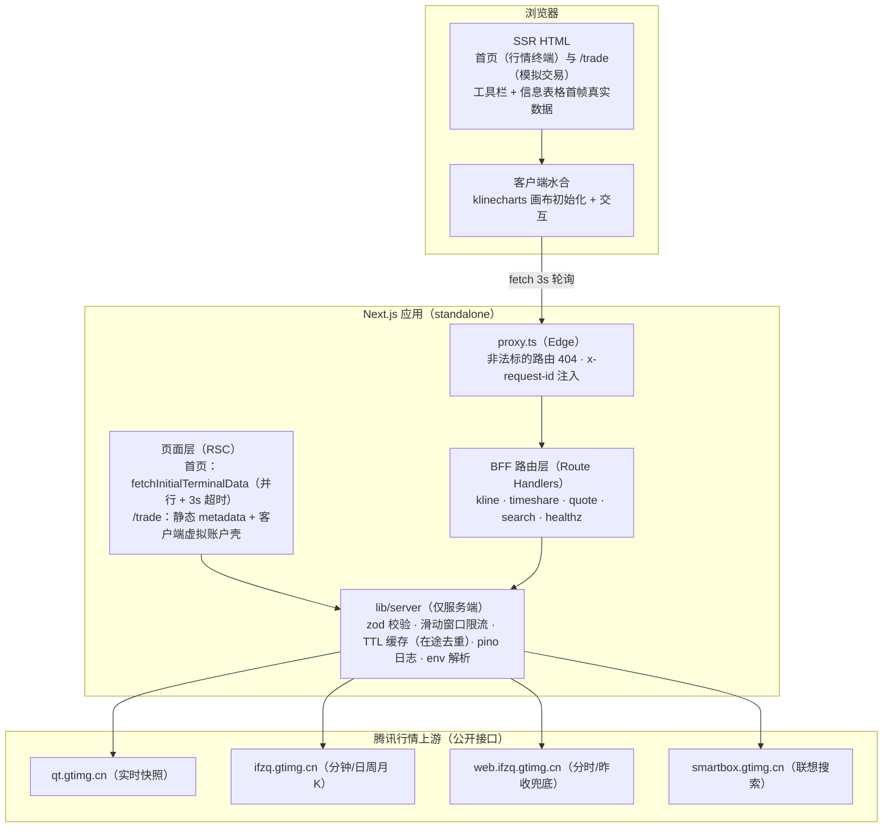
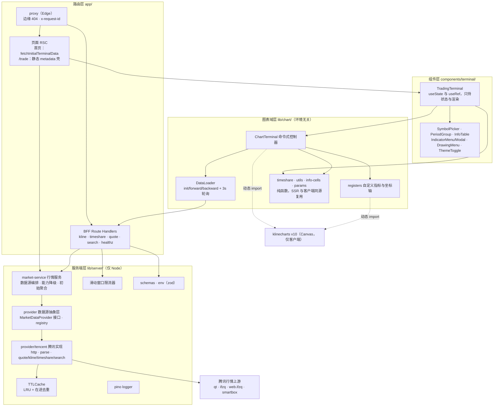
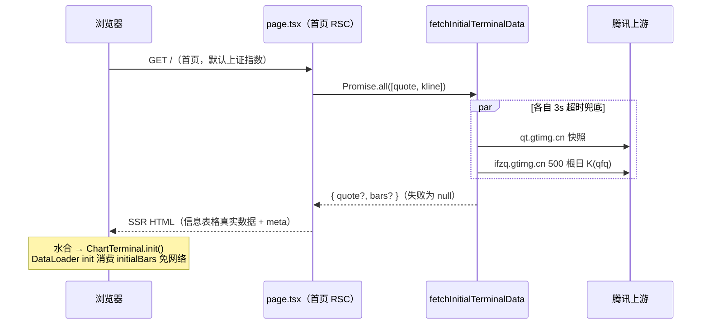
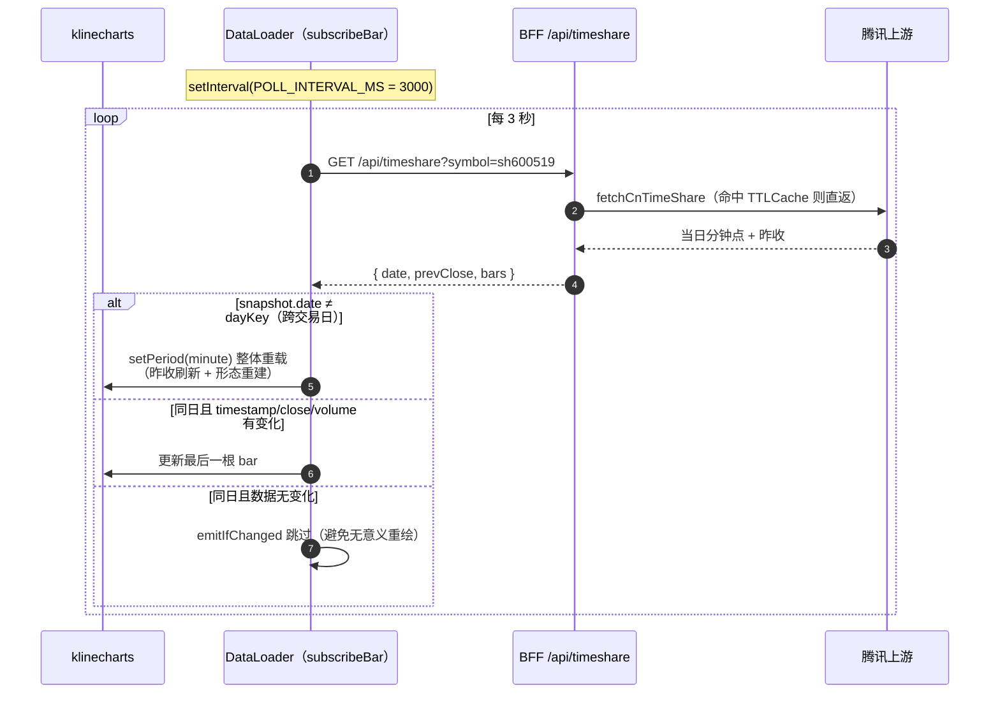
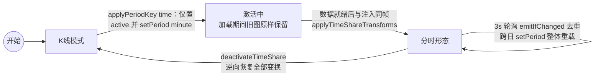
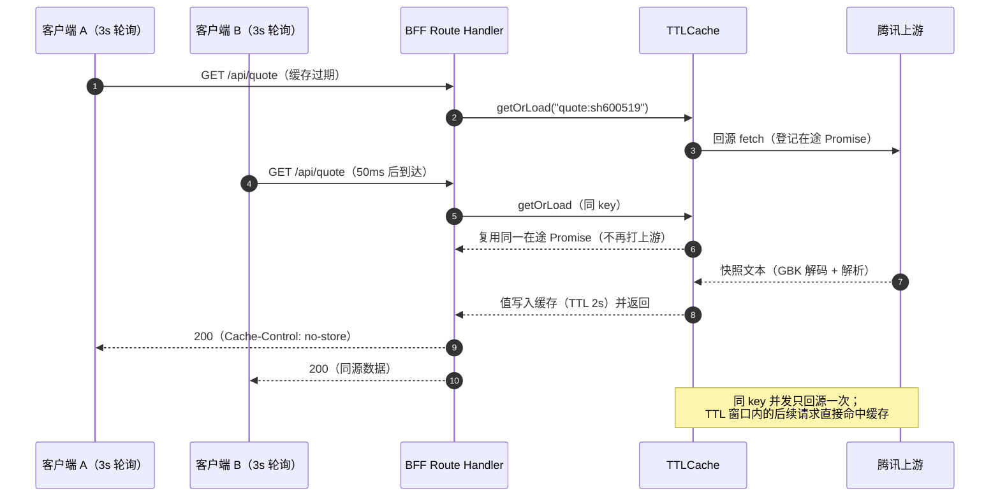
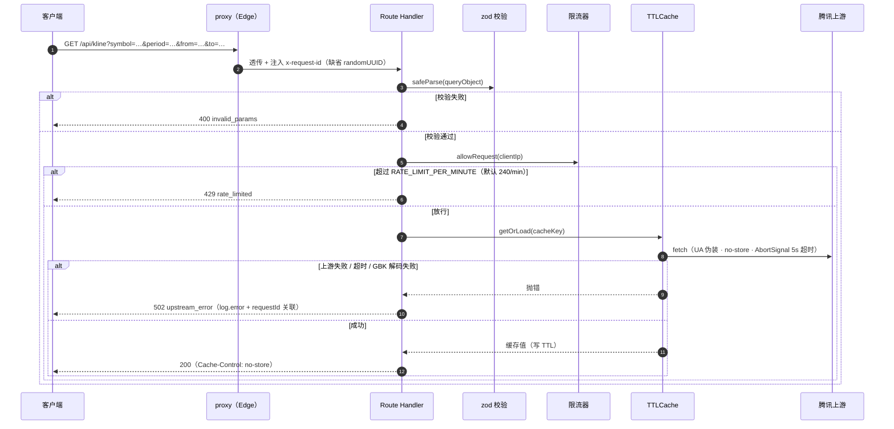
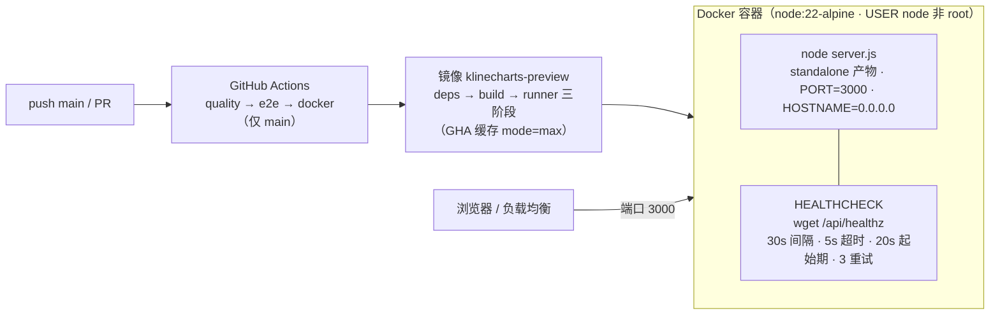

# 技术架构文档

> KLineChart A 股行情预览 + 模拟交易（`@klinecharts/preview`）
> 基于 Next.js 16（App Router）+ React 19 + klinecharts v10 的 SSR 行情终端，覆盖沪（sh）、深（sz）、北（bj）三市场；
> 另含 `/trade` 模拟交易页（客户端虚拟账户 + BFF 行情轮询，A 股语义仿真）。

---

## 目录

1. [项目定位与设计目标](#1-项目定位与设计目标)
2. [总体架构](#2-总体架构)
3. [技术选型](#3-技术选型)
4. [分层设计](#4-分层设计)
5. [关键机制详解](#5-关键机制详解)
6. [BFF 接口设计](#6-bff-接口设计)
7. [目录结构](#7-目录结构)
8. [工程化与质量保障](#8-工程化与质量保障)
9. [部署架构](#9-部署架构)
10. [可观测性与安全](#10-可观测性与安全)
11. [已知限制与演进方向](#11-已知限制与演进方向)

---

## 1. 项目定位与设计目标

本项目是由原「纯客户端 SPA」改造而来的**全量服务端渲染（SSR）+ BFF 行情代理**架构的 A 股行情终端（K 线预览 + 模拟交易）。核心设计目标：

| 目标                 | 实现手段                                                                                                                      |
| -------------------- | ----------------------------------------------------------------------------------------------------------------------------- |
| **首屏可用**         | 服务端并行拉取实时快照 + 初始日 K（3s 超时兜底），信息表格直出真实行情，图表 init 免首轮网络往返                              |
| **页面 metadata**    | 首页与 `/trade` 页注入标题与描述（`[symbol]` 动态标的路由与 `generateMetadata` 已随路由收敛移除，标的切换为纯客户端不落 URL） |
| **上游解耦**         | 腾讯行情统一在服务端聚合：GBK 解码、超时兜底、TTL 缓存、参数校验、按 IP 限流                                                  |
| **解锁浏览器端能力** | smartbox 联想接口无 CORS 头，经 BFF 代理后支持按**名称/拼音**搜索标的（原 SPA 仅支持 6 位代码）                               |
| **A 股语义正确**     | 红涨绿跌按昨收判定、量柱颜色与 K 线同步、分时均价口径按个股/指数区分                                                          |

**一条贯穿全局的约束**：klinecharts 是 Canvas 库，官方明确不支持服务端初始化。因此架构上强制「**图表不参与 SSR**」——所有 klinecharts 相关模块经动态导入隔离在客户端，服务端只渲染外壳（工具栏 + 信息表格）与数据。

---

## 2. 总体架构



**请求链路（两类）：**

1. **页面请求**：浏览器 → `proxy`（边缘校验 + requestId）→ RSC 页面 → `fetchInitialTerminalData`（服务端并行拉 quote + 500 根日 K，各自 3s 超时，失败回退 null 不阻塞渲染）→ SSR HTML → 客户端水合 → `ChartTerminal.init()` 动态加载 klinecharts。
2. **数据请求**：水合后图表 → BFF Route Handler（zod 校验 → 限流 → TTL 缓存/在途去重 → 上游 fetch，GBK 解码 + 5s 超时）。

**分层依赖规则**：`app/`（路由与 BFF）→ `components/`（React 视图）→ `lib/chart/`（与环境无关的图表域逻辑，可被 SSR 与客户端共同引用）→ `lib/server/`（仅服务端，纯 Node 依赖）。`lib/chart/terminal.ts`、`registers.ts` 内部对 klinecharts 一律动态 `import()`，保证不进入服务端模块图。

---

## 3. 技术选型

| 依赖                                                | 版本    | 选型理由                                                                |
| --------------------------------------------------- | ------- | ----------------------------------------------------------------------- |
| Next.js（App Router, standalone）                   | ^16.3.5 | SSR / Route Handlers（BFF）一体；standalone 产物适配容器化              |
| React + TypeScript（strict）                        | ^19.3.0 | UI 层；组件只持状态，图表操作收敛到 `ChartTerminal` 命令式控制器        |
| klinecharts                                         | ^10.0.3 | 图表引擎：可注册自定义指标/坐标轴、DataLoader 回调式取数、多语言/时区   |
| zod                                                 | ^4.6.5  | 边界参数校验（API 查询参数、环境变量启动期快速失败）                    |
| pino                                                | ^10.3.1 | 结构化日志，requestId 关联                                              |
| Vitest + Testing Library                            | ^5.0.1  | 纯函数 / DataLoader / 控制器（mock klinecharts）/ 组件测试              |
| Playwright                                          | ^1.63.0 | E2E 冒烟（SSR HTML 断言 + 水合出 canvas），webServer 与 Docker 镜像同构 |
| ESLint + Prettier + stylelint + husky + lint-staged | —       | 代码规范与提交门禁（stylelint 管控 UI 设计令牌）                        |
| Docker（多阶段）+ GitHub Actions                    | —       | 交付与 CI/CD                                                            |

运行要求：Node.js ≥ 20.9（Docker/CI 使用 node:22-alpine）。

---

## 4. 分层设计

### 4.0 分层架构图



### 4.1 路由层（`app/`）

| 文件                                          | 职责                                                                                                                         |
| --------------------------------------------- | ---------------------------------------------------------------------------------------------------------------------------- |
| `layout.tsx`                                  | `metadataBase` 取 `SITE_URL`、title 模板 `%s \| KLineChart`、`<div id="app">` 样式命名空间                                   |
| `page.tsx`                                    | 首页（默认上证指数 sh000001），`dynamic = 'force-dynamic'`；`fetchInitialTerminalData` 服务端并行拉取快照与初始日 K 直出首屏 |
| `trade/page.tsx`                              | 模拟交易页，`dynamic = 'force-dynamic'` + 静态 `metadata`；页面只做壳，虚拟账户与轮询全在客户端（见 4.6）                    |
| `loading.tsx` / `error.tsx` / `not-found.tsx` | 骨架屏 / 客户端错误边界（含 Sentry 挂点）/ 404 提示                                                                          |
| `api/*/route.ts`                              | BFF 六接口（见第 6 节）                                                                                                      |

### 4.2 边界代理与启动钩子

- **`proxy.ts`**（Edge，matcher 排除 `_next/static`、`_next/image`）：
  - **边缘 404**：单段路径、非保留段（`api`、`_next`、`favicon.ico`、`logo.svg`、`robots.txt`、`trade`）且不匹配 `^(sh|sz|bj)\d{6}$` 时直接返回内联 404。动机：Next 流式响应下页面内 `notFound()` 在响应头冲刷后抛出，无法再改状态码。匹配标的模式的路径放行后由 Next 渲染 `not-found.tsx` 兜底（`[symbol]` 路由已移除）。
  - **`x-request-id` 注入**：已有则透传，否则 `crypto.randomUUID()` 写回响应头，供日志关联。
- **`instrumentation.ts` / `instrumentation-node.ts`**：按 `NEXT_RUNTIME` 静态判定仅 Node 运行时加载 node 分支——启动日志（node 版本/pid）+ `SIGTERM`/`SIGINT` 优雅停机记录；Edge bundle 中被摇树移除。

### 4.3 BFF 服务端层（`lib/server/`，仅服务端）

| 模块                | 职责                                                                                                                                                                                                                                                               |
| ------------------- | ------------------------------------------------------------------------------------------------------------------------------------------------------------------------------------------------------------------------------------------------------------------ |
| `market-service.ts` | 行情服务（BFF 与页面的唯一入口）：按 `DATA_PROVIDER` 取数据源实例；能力降级（无分时 → 当日 1 分钟 K 合成，无联想搜索 → 代码精确匹配）；`fetchInitialTerminalData` 聚合                                                                                             |
| `provider/`         | 数据源抽象层：`types.ts`（`MarketDataProvider` 接口 + `ProviderCapabilities`）、`registry.ts`（env 选择，进程内单例）、`periods.ts`（周期兜底）、`contract.ts`（契约测试套件）                                                                                     |
| `provider/tencent/` | 腾讯数据源实现（唯一上游出口）：`http.ts` 传输（UA/Referer 伪装、GBK 解码、超时）、`parse.ts` 协议解析（qt 行情、K 线行、分时点、smartbox、周期映射）、`quote/kline/timeshare/search` 四类接口、`index.ts` 组装与缓存策略（raw/hist 分层，key 带 `tencent:` 前缀） |
| `cache.ts`          | `TTLCache<T>`：LRU 淘汰 + 过期清扫 + **在途请求去重**                                                                                                                                                                                                              |
| `rate-limit.ts`     | `SlidingWindowRateLimiter`：按 IP 精确滑动窗口                                                                                                                                                                                                                     |
| `schemas.ts`        | zod 查询参数 schema（symbol 正则、period 枚举、from<to、q 长度 1–40）                                                                                                                                                                                              |
| `api.ts`            | 路由公共工具：`jsonOk/jsonError`（统一 `Cache-Control: no-store`）、进程级共享限流器、`requestIdOf`、`queryObject`                                                                                                                                                 |
| `env.ts`            | zod 校验环境变量，进程内懒解析一次，非法值启动期快速失败                                                                                                                                                                                                           |
| `logger.ts`         | pino 全局 logger + `requestLogger(requestId)` 派生 child logger                                                                                                                                                                                                    |

### 4.4 图表域层（`lib/chart/`，环境无关 + 客户端图表控制器）

| 模块                | 职责                                                                                                        |
| ------------------- | ----------------------------------------------------------------------------------------------------------- |
| `terminal.ts`       | **`ChartTerminal` 类**：封装 klinecharts 全部命令式交互（详见 5.2）                                         |
| `data-loader.ts`    | **`createDataLoader`**：klinecharts DataLoader 协议的 BFF 实现（init/forward/backward + 3s 轮询，详见 5.3） |
| `registers.ts`      | `setupChartRegisters(locale)`：动态 import klinecharts 后注册自定义坐标轴与指标（详见 5.4）                 |
| `timeshare.ts`      | 分时状态机纯函数：点解析/差分、均价口径、对称区间、百分比换算、X 轴锚点；模块级 `timeShareState` 单例       |
| `utils.ts`          | 时间解析（3 种格式）、K 线解析与坏行过滤、毫秒桶聚合（4h 周期）、市场推断、昨收提取                         |
| `info-cells.ts`     | 信息表格 16 格单元格构建（SSR 直出与客户端联动同源）                                                        |
| `params.ts`         | 指标参数弹窗辅助（标签/钳制/取整）                                                                          |
| `constants.ts`      | 周期表、指标清单、绘图工具、A 股配色、分时常量等                                                            |
| `api.ts`            | 客户端 BFF 请求封装（失败静默返回 null，由调用方兜底）                                                      |
| `types.ts`          | `SymbolRef`、`QuoteSnapshot`、`FundamentalData`、`SYMBOL_PATTERN` 等类型与校验                              |
| `../fundamental.ts` | 基本面展示回溯（悬停 K 线按价格比例近似）+ 信息表格渲染数据                                                 |
| `../i18n.ts`        | 极简双语：`中文\|English` 键 + `#en-US` hash 读取（兼容原 SPA）                                             |

### 4.5 组件层（`components/terminal/`）

`TradingTerminal` 为顶层组件（工具栏 + 信息表格 + 画布 + 指标弹窗），**服务端渲染首帧**。Props：`{ market, ticker, initialQuote, initialBars }`——`initialQuote` 为 null 表示上游超时/失败，由客户端补拉。

状态管理：**无第三方状态库**，纯 `useState`/`useRef`。图表相关状态（周期、主/副图指标、绘图工具、主题、`InfoSnapshot` 信息快照）统一收敛在 `useChartTerminal` 钩子，信息快照由控制器经 `onInfoUpdate` 单向回写；组件层只持标的名称、指标参数弹窗等少量本地状态。终端随挂载条件整体重建，此后切标的走 `setSymbol` 增量同步。

子组件一览：

| 组件               | 职责要点                                                                                                          |
| ------------------ | ----------------------------------------------------------------------------------------------------------------- |
| `SymbolPicker`     | 标的搜索下拉：空查询展示 6 个默认指数；输入 **300ms 防抖** 调 `/api/search`；结果与关键词绑定防过期；支持键盘选择 |
| `PeriodGroup`      | 日/周/月常驻，分时 + 分钟/小时周期收进「周期」下拉并高亮当前项                                                    |
| `InfoTable`        | 渲染 `buildInfoCells` 产物；空数据时显示加载占位                                                                  |
| `IndicatorMenu`    | 主图/副图指标复选下拉（复用两次，id 区分）                                                                        |
| `IndicatorModal`   | 指标参数设置弹窗：条件挂载（每次打开重置）、min 钳制、整数/小数 step 区分、四种关闭途径（取消/×/遮罩/Esc）        |
| `DrawingMenu`      | 11 种绘图工具下拉                                                                                                 |
| `ThemeToggle`      | 明暗主题开关（深色由 `#app.dark` 类驱动 CSS 变量）                                                                |
| `useChartTerminal` | 图表终端交互钩子（行情页与交易页共用）：ChartTerminal 生命周期（创建/销毁/切标的/主题）与周期、指标、绘图控件状态 |
| `useDismiss`       | 下拉/弹窗外点击 + Esc 关闭通用 hook                                                                               |

**客户端切标的不走服务端导航**：经 `ChartTerminal.setSymbol` 增量同步（URL 不变，刷新回默认标的），水合后的数据请求走 BFF。

### 4.6 模拟交易层（`components/trading/` + `lib/trading/`）

`/trade` 页（`PaperTrading`）为纯客户端虚拟账户：localStorage 持久化、BFF 行情 3s 轮询（当前标的 + 持仓标的，与行情终端同频）、跨交易日自动滚动当日盈亏基准并解冻 T+1 持仓；行情图表复用行情页组件（`useChartTerminal` + 精简周期组），与交易标的双向同步。

| 模块                                     | 职责                                                                                                        |
| ---------------------------------------- | ----------------------------------------------------------------------------------------------------------- |
| `lib/trading/account.ts`                 | 交易域纯函数（带测试）：账户创建/持久化、整手买入、T+1 可卖、涨跌停校验、佣金/印花税/过户费、权益与盈亏计算 |
| `PaperTrading.tsx`                       | 交易页主组件：账户状态、轮询编排、图表 / 委托 / 持仓三区布局                                                |
| `OrderPanel.tsx`                         | 买/卖委托面板：现价跟随、整手快捷仓位、费用预估（校验与成交在父组件完成）                                   |
| `PositionsTable.tsx` / `TradesTable.tsx` | 持仓列表（现价取轮询行情，缺省回退成本价）与成交记录                                                        |

---

## 5. 关键机制详解

### 5.1 SSR 首屏数据注入



`DataLoader.getBars` 的 init 分支：**仅日 K 且 code 匹配时**直接消费 SSR 注入的 `initialBars` 回调返回（免首轮请求），消费一次后置 null；`ChartTerminal` 侧在 `initialQuote == null` 时客户端补拉 `/api/quote` 兜底。

### 5.2 ChartTerminal：命令式控制器

`ChartTerminal`（`lib/chart/terminal.ts`）把 klinecharts 的命令式 API 与 React 隔离开——React 层只持状态与渲染，命令经方法下发（`setSymbol / applyPeriodKey / toggleMainIndicator / toggleSubIndicator / startDrawing / setTheme / overrideIndicatorParams` …）。

- **init 顺序**：`await import('klinecharts')` → `setupChartRegisters(locale)` → `klinecharts.init(container, { locale, timezone: 'Asia/Shanghai' })` → `setDataLoader` → `setSymbol` → A 股配色 → tooltip 样式 → 创建 MA（candle_pane）/VOL/MACD → `setPeriod(day)` → 十字光标桥 → `emitInfo`。
- **A 股配色**：`candle.bar.compareRule: 'previous_close'` + 全套红涨绿跌（`#ef2323` / `#14a143`），含边框、影线、最新价标记与指标量柱。
- **candle tooltip**：隐藏标题行；MA 名称与数值并入首行（颜色随均线，实时取自主图 MA 状态——改参数、分时移除 MA 时自动跟随）。
- **destroy**：置 destroyed 标志 → 跑 disposers → `klinecharts.dispose(container)` → `resetTimeShareState()`，防泄漏且不再响应迟到的异步回调。

### 5.3 DataLoader：取数与轮询语义

`createDataLoader`（`lib/chart/data-loader.ts`）实现 klinecharts 的 `DataLoader` 协议：

| 能力                   | 实现                                                                                                                                |
| ---------------------- | ----------------------------------------------------------------------------------------------------------------------------------- |
| **init**               | 时间窗 `from = to − BAR_LIMIT(500) × span`；分时激活时改拉 `/api/timeshare` 全量                                                    |
| **forward / backward** | 分别以 `to = timestamp − 1` / `from = timestamp + 1` 向更早加载，每次 500 根                                                        |
| **3s 轮询**            | `subscribeBar` 内 `setInterval(POLL_INTERVAL_MS = 3000)` 替代 WebSocket（A 股无免费浏览器 WS 行情）；普通周期轮询窗口取最近 20 根   |
| **更新去重**           | `emitIfChanged`：timestamp/close/volume 均未变化则跳过，避免无意义重绘                                                              |
| **订阅过期守卫**       | 订阅快照时分时状态 `pollTimeShare !== timeShareState.active` 即停止注入                                                             |
| **在途切走保护**       | 加载期间切换周期/标的则放弃注入旧响应                                                                                               |
| **跨日重载**           | 分时轮询发现 `snapshot.date !== dayKey` 时 `setPeriod(minute)` 整体重载（含昨收刷新），自动切到新交易日                             |
| **防死循环**           | 分时模式下 forward/backward 直接回空且 `{ forward: false, backward: false }`（否则与 `setOffsetRightDistance(0)` 联动反复触发请求） |

**轮询与跨日重载时序图：**



### 5.4 分时状态机

分时不是普通周期，而是一组联动的形态变换，由 `timeShareState` 单例（`active / prevClose / dayKey / lotSize / isIndex`）驱动：



- **形态延迟应用**：激活仅切周期；指标/坐标轴/样式变更延迟到数据就绪后与注入**同帧**执行——旧图保持显示直至被一次重绘替换，无白屏无中间形态。上游失败也切形态（空网格 + 轮询补数）。
- **`applyTimeShareTransforms`**：移除主图 MA → 挂 `TIME` 指标（均价线 + 昨收基准虚线）→ `createYAxis` 左侧百分比轴（`cnTimePercent`，幂等防重）→ `overrideYAxis`（昨收居中对称区间 + 0.08/0.08 留白）→ `overrideXAxis`（交易时段锚点 `09:30 / 10:30 / 11:30 / 13:00 / 14:00 / 15:00`，窄屏 <360px 精简为 3 个）→ 主图切面积走势线。
- **全天一屏校准** `calibrateTimeShareFit`：最多 3 轮「resize → 读画布宽 → width/242 定 barSpace → `setOffsetRightDistance` 右侧留白」迭代收敛（Y 轴宽度随刻度文本变化会改变内容宽），最后补一次全量布局；`fitTimeShareBars` 以 1.5s timer 兜底复校。
- **均价线口径**：个股 = 累计成交额 ÷ (累计量 × 每手股数)（科创板 200 股/手自动换算、北交所缺额近似）；**指数** = 按量加权的点位均值（指数额/量与点位差两个数量级，不能混用公式）。

### 5.5 自定义注册（`registers.ts`）

| 注册名          | 类型             | 要点                                                                                           |
| --------------- | ---------------- | ---------------------------------------------------------------------------------------------- |
| `cnTimePercent` | Y 轴             | 涨跌幅百分比轴：`realValue ↔ display` 按昨收双向换算，文本 `+x.xx%`                            |
| `TIME`          | 指标             | 分时均价线（橙色）+ `draw` 内绘制昨收基准虚线（`setLineDash([4,3])`）                          |
| `VOL`           | 指标（覆盖内置） | 量柱红绿**与前一根收盘比较**（首根退回当日开盘），与 K 线按昨收判定的颜色同步；MA 滑动求和优化 |
| `MA`            | 指标（覆盖内置） | `calcParams [5,10,30,60]`；tooltip legends 返回空——名称数值并入 candle 首行                    |
| `TURNOVER`      | 指标             | 换手率近似（`volume / maxVolume × 100`，无流通股本数据的相对值）                               |
| `AMPLITUDE`     | 指标             | 振幅（`(high − low) / 前收盘 × 100`，首根前取自身开盘）                                        |

注册经动态 import 完成且幂等；shortName/title 按调用时 locale 固化（切语言需刷新，已知限制）。

### 5.6 十字光标桥与信息表格联动

- 库的 `onCrosshairChange` 回调参数是原始 `{x, y, paneId}`（不含 K 线数据），需经 `convertFromPixel([{x}])` 反查 dataIndex 取 K 线。
- 关闭鼠标选择（**右键 contextmenu 切换**，preventDefault）时：监听变化把带 x 的 crosshair 重新钉回 `{}`（归一化指向最后一根）；`mouseleave` 自行恢复最后一根；`onVisibleRangeChange` 在未悬停时刷新最新一根。
- `emitInfo` 组装 `{ dataList, hovered, fundamental, intraday }` 经 `onInfoUpdate` 单向推给 React → `buildInfoCells` 渲染 16 格（行情行红涨绿跌按昨收判定；基本面行中性色）。**悬停历史 K 线时**：振幅/换手由 K 线精确重算，市盈/市净/市值/均价按 `hovered.close / last.close` 价格比例回溯。

### 5.7 服务端缓存与限流

**`TTLCache<T>`（进程内）**：

- LRU：get 命中后 delete+set 重插刷新热度；set 超 `maxEntries`（2000）淘汰最旧键。
- **在途请求去重** `getOrLoad`：同 key 并发请求共享同一 pending Promise——多客户端 3s 同频轮询**只打一次上游**，这是轮询架构成立的关键。
- `sweep()`：条目数达 `maxEntries × 2` 时全量清理过期项，防长期运行内存增长。

**在途请求去重时序图**（多客户端同频轮询只打一次上游）：



**`SlidingWindowRateLimiter`（精确滑动窗口）**：`hits: Map<key, number[]>` 存时间戳，`check` 过滤 `now − 60s` 窗口内命中数与阈值（默认 240/分钟/IP）比较；`maxKeys = 10000` 防键泄漏。client key：`x-forwarded-for` 首段 → `x-real-ip` → `'unknown'`。

**缓存 TTL 与轮询对齐**：quote/timeshare 2s（适配 3s 轮询）、kline 近端 3s / 历史窗口 10min（raw/hist 分层，历史不可变）、search 5min，均可经环境变量调整。

### 5.8 上游适配（`provider/tencent/`）

行情数据源经 `MarketDataProvider` 接口抽象（`lib/server/provider/types.ts`），`market-service.ts` 是 BFF 与页面的唯一入口，`registry.ts` 按 `DATA_PROVIDER` 环境变量选择实现——切换数据服务商只需新增 provider 目录并通过契约测试（`contract.ts`），路由与前端零改动。能力缺口由服务层降级：无原生分时 → 当日 1 分钟 K 合成；无联想搜索 → 6 位代码精确匹配；缺口周期（如 4h）由 `periods.ts` 计划基周期拉取后本地聚合。

腾讯实现的接口端点：

| 接口       | URL                                              | 用途                                |
| ---------- | ------------------------------------------------ | ----------------------------------- |
| 实时快照   | `qt.gtimg.cn/q={code}`                           | 名称/现价/昨收 + 基本面字段         |
| 分钟 K     | `ifzq.gtimg.cn/appstock/app/kline/mkline`        | m1/m5/m15/m30/m60                   |
| 日/周/月 K | `ifzq.gtimg.cn/appstock/app/fqkline/get?...qfq`  | 前复权                              |
| 分时       | `web.ifzq.gtimg.cn/appstock/app/day/query`       | 当日分钟点                          |
| 昨收兜底   | `web.ifzq.gtimg.cn/.../fqkline/get?...,day,,,6,` | qt[4] 缺失时取 6 根日 K             |
| 搜索       | `smartbox.gtimg.cn/s3/?v=2&q=&t=all`             | 名称/拼音联想（服务端无 CORS 限制） |

适配要点：

- **GBK 解码**：`new TextDecoder('gbk').decode(arrayBuffer)`；Node 构建缺完整 ICU 时降级 utf-8 并 `logger.warn`（中文可能乱码但不阻断数字字段）。
- **请求伪装与超时**：Chrome UA + `Referer: gu.qq.com`、`cache: 'no-store'` 绕过 Next 数据缓存、`AbortSignal.timeout(UPSTREAM_TIMEOUT_MS = 5000)`。
- **边界补丁**：K 线窗口覆盖今天时 `end` 参数必须留空（腾讯带 end 会漏当天 bar）；4h 周期用 m60 拉取后 `aggregateBars` 毫秒桶本地聚合；分时昨收缺失三级兜底（6 根日 K → qt[4] → 首根 close）。
- **搜索双路**：6 位代码精确匹配（可带前缀，缺省 `guessCnMarket` 推断：`60/68/900→sh`、`43/83/87/88/92→bj`、其余→sz）走 quote 取名；否则 smartbox 联想（防御性解析：正则抽取 + 单引号转双引号 JSON.parse + 过滤非 A 股市场）。

---

## 6. BFF 接口设计

统一处理模式：`requestLogger(requestIdOf)` → zod `safeParse` 失败 `400 invalid_params` → `allowRequest` 失败 `429 rate_limited` → 业务调用（经 TTL 缓存）→ catch 时 `log.error` + `502 upstream_error`。全部 `dynamic = 'force-dynamic'`，响应统一 `Cache-Control: no-store`（新鲜度由服务端 TTL 缓存管理）。

| 路径                 | 参数                                                          | 返回                               | 上游             |
| -------------------- | ------------------------------------------------------------- | ---------------------------------- | ---------------- |
| `GET /api/kline`     | `symbol, period, from, to`（period 二次校验，不支持周期 400） | `{ bars: KLineData[] }`            | 分钟/日周月 K    |
| `GET /api/timeshare` | `symbol`                                                      | `{ date, prevClose, bars }`        | 分时 + 昨收兜底  |
| `GET /api/quote`     | `symbol`                                                      | 名称/现价/昨收 + 基本面            | qt 快照          |
| `GET /api/search`    | `q`（trim 后 1–40 字符）                                      | `{ items }`（代码精确 + 名称联想） | quote / smartbox |
| `GET /api/healthz`   | -                                                             | `{ status, uptime, timestamp }`    | -                |

**BFF 请求处理时序图：**



---

## 7. 目录结构

```
├── app/
│   ├── layout.tsx            # 根布局（meta / #app 命名空间）
│   ├── page.tsx              # 首页（默认上证指数 sh000001）
│   ├── trade/page.tsx        # 模拟交易页（静态 metadata + 客户端虚拟账户壳）
│   ├── loading/error/not-found.tsx
│   └── api/                  # BFF：kline / timeshare / quote / search / sim（state/orders/session/replay）/ healthz
├── components/
│   ├── terminal/             # TradingTerminal 及工具栏 / 信息表格 / 弹窗组件
│   └── trading/              # PaperTrading / OrderPanel / PositionsTable / TradesTable
├── lib/
│   ├── chart/                # 与环境无关的图表域逻辑（terminal / data-loader /
│   │                         #   registers / timeshare / utils / info-cells / params / ...）
│   ├── server/               # 仅服务端：market-service / provider 数据源层（tencent 实现）/
│   │                         #   TTL 缓存 / 限流 / zod / pino / env
│   ├── trading/account.ts    # 模拟交易纯函数（整手/T+1/涨跌停/费用，带测试）
│   ├── fundamental.ts        # 基本面展示回溯 + 信息表格渲染数据
│   └── i18n.ts               # 双语文案（#en-US hash）
├── e2e/                      # Playwright 冒烟
├── tests/                    # ChartTerminal 集成测试（mock klinecharts）
├── proxy.ts                  # 边缘 404 + x-request-id
├── instrumentation*.ts       # 启动日志 + 优雅停机（Node 分支）
├── docs/                     # ARCHITECTURE / DIRECTORY / UI_SPEC（UI 设计规范）
├── AGENTS.md · .trae/rules/  # AI agent 指引与项目规则
├── Dockerfile / .github/workflows/ci.yml
└── vitest.config.ts / playwright.config.ts / eslint.config.mjs / stylelint.config.mjs
```

---

## 8. 工程化与质量保障

### 8.1 测试金字塔

| 层                 | 工具                          | 覆盖点                                                                                                                                                                                                                        |
| ------------------ | ----------------------------- | ----------------------------------------------------------------------------------------------------------------------------------------------------------------------------------------------------------------------------- |
| 纯函数             | Vitest                        | 时间解析、K 线解析与坏行过滤、聚合、市场/指数识别、分时点解析（量额差分、科创板、北交所）、均价四口径、对称区间、参数钳制、信息表格构建、smartbox/qt 解析、TTL 缓存（含并发去重）、限流窗口、模拟交易域（费用/权益/整手/T+1） |
| DataLoader         | Vitest                        | init/forward/backward 语义、SSR 首屏注入与单次消费、失败兜底、在途切走保护、轮询去重、跨日重载（fake timers）、分时防死循环                                                                                                   |
| ChartTerminal 集成 | Vitest（vi.mock klinecharts） | 初始化顺序、A 股配色、分时状态机（激活仅切周期 → 同帧形态 → 全天一屏校准 → 逆向恢复）、右键十字光标、主题重放、destroy 释放                                                                                                   |
| 组件               | Testing Library               | 指标参数弹窗全交互路径（含四种关闭途径、参数钳制、双语）                                                                                                                                                                      |
| E2E                | Playwright                    | SSR HTML 断言、水合出 canvas、非法路由 404（边缘拦截）、健康检查、BFF 参数校验（注：`/sh600519` 动态路由用例已随路由移除失效，待同步删除）                                                                                    |

### 8.2 规范与门禁

- ESLint（flat config，next/core-web-vitals + TS）+ Prettier + stylelint（UI 令牌强约束，规则见 `docs/UI_SPEC.md`）；husky pre-commit + lint-staged（ts/tsx 走 eslint --fix + prettier，css 走 stylelint --fix + prettier）。
- `npm run typecheck`（tsc --noEmit，strict）。
- Playwright `webServer` 与 Docker 镜像**同构**：build → 拷 static/public 进 standalone → `node .next/standalone/server.js`，就绪探针 `/api/healthz`——E2E 验证的即是生产形态。

---

## 9. 部署架构

### 9.0 部署架构图



### 9.1 Docker（三阶段）

```
deps   → node:22-alpine，npm ci（仅 package.json + lock）
build  → 拷 node_modules + 源码，NEXT_TELEMETRY_DISABLED=1，npm run build
runner → NODE_ENV=production，拷 public/.next(standalone,static)（--chown=node），
         USER node（非 root），EXPOSE 3000，
         HEALTHCHECK：30s 间隔 / 5s 超时 / 20s 起始期 / 3 重试 → wget /api/healthz
```

### 9.2 CI/CD（GitHub Actions，push main + PR 触发，按 ref 取消旧运行）

```
quality（format:check → lint → lint:css → typecheck → vitest）
   ├─→ e2e（缓存 Playwright 浏览器 → install chromium → test:e2e；失败上传报告保留 7 天）
   └─→ docker（仅 main：buildx 构建镜像不推送，GHA 缓存 mode=max）
```

### 9.3 环境变量（`lib/server/env.ts` zod 校验，启动期快速失败）

| 变量                                            | 默认      | 说明                                                       |
| ----------------------------------------------- | --------- | ---------------------------------------------------------- |
| `LOG_LEVEL`                                     | `info`    | pino 级别                                                  |
| `DATA_PROVIDER`                                 | `tencent` | 行情数据源（provider/registry 登记项）                     |
| `UPSTREAM_TIMEOUT_MS`                           | `5000`    | 上游超时（≤ 30000）                                        |
| `CACHE_QUOTE_TTL_MS` / `CACHE_TIMESHARE_TTL_MS` | `2000`    | 与 3s 轮询对齐                                             |
| `CACHE_KLINE_TTL_MS`                            | `3000`    | K 线近端缓存（与轮询对齐，回源频率与用户数无关）           |
| `CACHE_KLINE_HIST_TTL_MS`                       | `600000`  | K 线历史窗口缓存（历史不可变；有界防除权后前复权全量重算） |
| `CACHE_SEARCH_TTL_MS`                           | `300000`  | 搜索联想缓存                                               |
| `RATE_LIMIT_PER_MINUTE`                         | `240`     | 每 IP 每分钟上限（≥ 10）                                   |

另有三个变量不经 zod schema，由运行时直接读取：`PORT` / `HOSTNAME`（Next standalone 服务监听，Docker 注入 `3000` / `0.0.0.0`）、`SITE_URL`（`layout.tsx` 读取作 metadata base，默认 `https://preview.klinecharts.com`）。

---

## 10. 可观测性与安全

- **结构化日志**：pino，`base: { service: 'klinecharts-preview' }`；每个请求经中间件注入 `x-request-id`，`requestLogger(requestId)` 派生 child logger 关联全链路。
- **生命周期日志**：instrumentation 记录启动（node 版本/pid）与 `SIGTERM`/`SIGINT` 优雅停机信号。
- **安全响应头**（`next.config.ts` 全站注入）：`X-Content-Type-Options: nosniff`、`X-Frame-Options: SAMEORIGIN`、`Referrer-Policy: strict-origin-when-cross-origin`；`poweredByHeader: false`。
- **边界防护**：zod 参数校验（400）、按 IP 滑动窗口限流（429）、上游超时与错误兜底（502）、边缘 404 拦截。
- **容器安全**：非 root 用户运行、standalone 最小产物。

---

## 11. 已知限制与演进方向

**已知限制**

- `[symbol]` 动态标的路由已移除：标的切换不落 URL（刷新回默认标的），`/sh600519` 等直访由 `not-found.tsx` 兜底。
- 指标参数设置弹窗入口保持隐藏（与原版一致）。
- 副图「换手率」指标为相对近似（无流通股本数据）；信息表格中的为接口真实值。
- 行情依赖腾讯公开接口，变更或限流时数据可能中断；SSR 上游超时回退客户端补拉，失败显示 `--` 占位。
- 语言切换沿用 `#en-US` hash，图表注册文案随加载时语言固化，切换需刷新。
- 进程内缓存与限流为**单实例语义**。

**演进方向**

- **多实例横向扩展**：将 `TTLCache` 与 `SlidingWindowRateLimiter` 替换为 Redis 实现（接口已收敛在 `lib/server`，改动面可控）。
- 错误上报接入 Sentry（`error.tsx` 已预留挂点）。
- 轮询可平滑升级为 SSE/WebSocket 推送（DataLoader 的 `subscribeBar` 协议不变，仅替换内部实现）。
